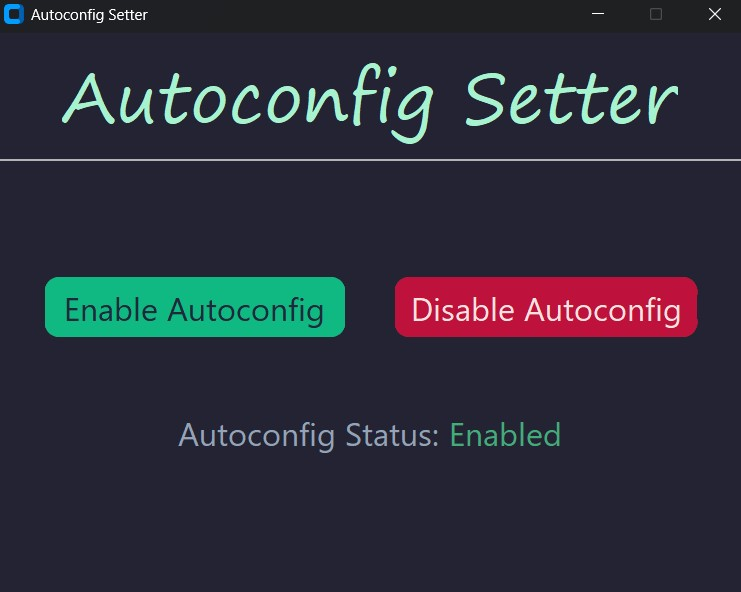

# Autoconfig Setter
A lightweight, modern Windows desktop utility built with **Python** and **CustomTkinter** to easily toggle and monitor the Windows Wi-Fi AutoConfig service.

  

## Features
- **Instant Status Monitoring:** Background worker tracks state changes instantly (whether toggled inside the app or externally via terminal/settings).
- **Zero CPU Waste:** Uses a low-overhead background thread with sleep intervals (`<1%` CPU utilization on average).
- **Dynamic Interface Detection:** Automatically finds the active wireless network adapter name (`Wi-Fi`, `Wi-Fi 2`, etc.).
- **Modern UI:** Clean, dark-mode interface styled with CustomTkinter.
- **UAC Elevation:** Automatically requests administrator permissions on startup to execute network configuration commands safely.
- **System Tray Support:** Hides in the system tray to enable easy use.

## Requirements
- **OS:** Windows 10 or higher
- **Python:** 3.8 or higher (if running source code)
- **CustomTkinter** 5.2.0 or higher (if running source code)
- **PyStray** 0.19.5 or higher (if running source code)
- **Pillow** 10.0.0 or higher (if running source code)

## Installation & Running from Source
- **To use source code:** Install dependencies (Python/CustomTkinter/Pystray/Pillow mentioned above), download source code from the releases tab, and run.

- **Pre-compiled Executable:** Alternatively, download the .exe from the releases tab and run. The only requirement is using Windows 10 or higher.

## Preview

  

## License & Attribution
### License
This project is open-source software licensed under the **MIT License** — see the [LICENSE](LICENSE) file for details.

---

### Attributions & Third-Party Credits
This project relies on the following open-source libraries and frameworks:

* **[Python](https://python.org)** — Created by the Python Software Foundation. Licensed under the [PSF License].
  * *Used for: Core programming language and runtime environment.*
* **[CustomTkinter](https://github.com/tomschimansky/customtkinter)** — Developed by Tom Schimansky. Licensed under the [MIT License].
  * *Used for: Modern, customizable graphical user interface (GUI) elements.*
* **[pystray](https://github.com/moses-palmer/pystray)** — Developed by Moses Palmér. Licensed under the [GNU Lesser General Public License v3.0 (LGPLv3)].
  * *Used for:* System tray icon management and cross-platform tray background threading.
* **[Pillow](https://python-pillow.org/)** — Developed by Jeffrey "Alex" Clark and contributors. Licensed under the [HPND License].
  * *Used for:* Loading and processing system tray and window icon graphics.
